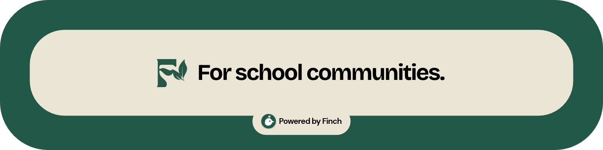
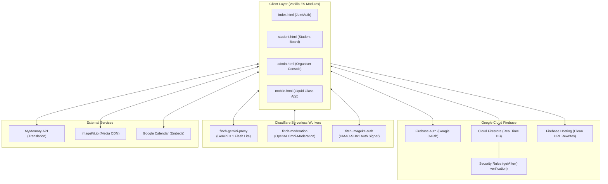

<p align="center">
  
</p>

> A secure real-time platform connecting students and their communities through information. Built for the Congressional App Challenge.

[](https://fitch-6393c.web.app)
[](https://firebase.google.com/)
[](https://workers.cloudflare.com/)
[](https://ai.google.dev/)
[](LICENSE)

---

## 📖 Overview

Communication within high schools can be frustrating. Whether it be paper flyers, boring morning announcements, or social media, students often miss out on important information. In diverse areas like Fitchburg, Lawrence, and Lowell, many students and families face language barriers, as I have experienced myself. Growing up in a Spanish-speaking household, we missed out on events and activities because my parents never knew or had the ability to access the information in their native language, and that is why I built Fitch.

Fitch aims to connect the whole school community by providing real-time announcements, Q&A with student officers, calendar integration, photo boards, live translation, and an AI assistant called Finch—all in one easy-to-use web application built without heavy frameworks.

---

## Features

### 1. Privacy-Focused Join (No PII)
* Students log in with a random 5-character alphanumeric code.
* No need to provide an email address, phone number, or password.
* Easy to comply with FERPA and COPPA standards.

### 2. Live Translation
* Real-time translation of announcements and Q&A using the MyMemory API, supporting Spanish, Portuguese, Chinese, and English and so many more languages.
* Built with request guards (`translationRequestId`) and memoization caching to ensure zero UI delay.

### 3. Finch (AI Assistant)
* Powered by Google Gemini 3.1 Flash Lite via a secure Cloudflare Worker proxy.
* Uses lightweight RAG to answer questions based on school handbooks, bell schedules, and club updates.

### 4. Two-Stage Moderation
* Live filtering combining a custom regex blocklist with an OpenAI Omni-Moderation serverless proxy.
* Blocks offensive or cyberbullying language before posts reach public feeds.

### 5. Role-Based Access Control (RBAC)
* **School Organisers:** Log in using Google OAuth to set up schools, change theme colors, toggle features, pin announcements, and invite officers.
* **Class Officers:** Verified users who can post announcements, moderate feeds, and reply to students with official badges.
* **Students:** Can view announcements, translate posts, and ask questions.

### 6. Custom Themes & Mobile
* Calculates hover and contrast colors based on a school's main hex code using RGB scaling (`* 0.78`).
* Dedicated mobile interface featuring amazing UI I made, safe area padding, and thumb-friendly layout.

---

## Architecture



---

## Security

* **No Client Secrets:** All API keys (`GEMINI_API_KEY`, `OPENAI_API_KEY`, `IMAGEKIT_PRIVATE_KEY`) are kept securely in Cloudflare Worker secrets.
* **Atomic `getAfter()`:** Promoting officers requires verification in Firestore security rules to match their invite record within the same batch.
* **Input Sanitisation:** URL helper functions strip phishing vectors and restrict calendar embeds to whitelisted domains.
* **Unsubscribe Listeners:** Real-time listeners (`onSnapshot`) automatically unsubscribe when navigating away to prevent memory leaks.

---

## Repository Structure

```text
├── index.html             # Home page, code login, and Google Sign-in
├── student.html / js      # Main student dashboard with Q&A
├── admin.html / js        # Organiser console
├── mobile.html / js / css # Mobile design with glassmorphism UI
├── activity.html / js     # Secure analytics dashboard
├── finch.js               # Client-side logic for Finch AI
├── moderation.js          # Client-side content moderation
├── photo-utils.js         # ImageKit upload and lightbox preview logic
├── calendar.js            # Google Calendar embed sanitizer
├── school-theme.js        # Calculate dynamic theme colors
├── firestore.rules        # Production database rules
├── firebase.json          # Deployment configuration
│
├── gemini-worker/         # Cloudflare Worker for Gemini AI
├── moderation-worker/     # Cloudflare Worker for content moderation
└── imagekit-worker/       # Cloudflare Worker for HMAC upload signing

```

---

## Quick Start

### Prerequisites

* [Node.js](https://nodejs.org/) (v18+)
* [Firebase CLI](https://firebase.google.com/docs/cli) (`npm install -g firebase-tools`)

### Commands

1. **Clone the repository:**
```bash
git clone [https://github.com/YOUR_USERNAME/fitch.git](https://github.com/YOUR_USERNAME/fitch.git)
cd fitch

```


2. **Run locally:**
```bash
firebase serve

```


Navigate to `http://localhost:5000` in your browser.
3. **Deploy:**
```bash
firebase deploy

```


---


*3rd Congressional District of Massachusetts (MA-03)*

This project was created to help student governments communicate better within their schools and ensure announcements are accessible to all students.


